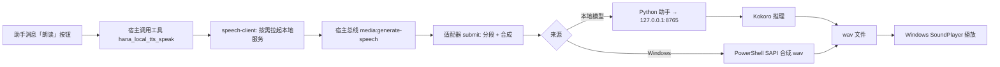

# 本地语音朗读 · hana-local-tts

> Hana Agent 本地语音朗读V2APP：支持 Windows 系统语音，也支持本机跑的 Kokoro 中文模型，推理全程离线，音频不出本机。

| 项目 | 内容 |
| --- | --- |
| 插件名称 | 本地语音朗读 |
| 插件 ID | `hana-local-tts` |
| 当前版本 | 0.9.14 |
| 宿主要求 | Hana Agent ≥ `1.2.1-beta`（manifest `minAppVersion`） |
| 支持平台 | Windows 10 / 11（x64）。依赖 PowerShell、Windows SAPI 和系统播放器，macOS / Linux 暂不支持 |
| 运行时依赖 | Node 由宿主提供；Python 3.12（插件可自动下载便携版，也可选用系统里已有的）；PyTorch `2.14.1`（CPU）或 `2.14.1+cu130`（GPU）；模型 `hexgrad/Kokoro-82M-v1.1-zh` |
| 磁盘占用 | 模型 314 MB + CPU 运行环境约 1.2 GB；装了 GPU 运行环境再加约 3.6 GB |
| 内存占用 | 服务常驻约 1–2 GB |
| 网络需求 | 只在安装期联网（下载 Python / 模型 / 依赖）。装好后朗读完全离线 |
| 许可证 | Apache License 2.0（[官方全文](https://www.apache.org/licenses/LICENSE-2.0)） |

仓库地址：`https://github.com/OWNER/REPO`（发布前把 `OWNER/REPO` 换成实际账号和仓库名）。

---

## 二、功能介绍

### 2.1 两种朗读来源

| 来源 | 说明 | 依赖 |
| --- | --- | --- |
| **Windows 系统语音** | 调用系统 SAPI 合成，音色就是你电脑上装的那批语音（含中文女声/男声）。零下载，开箱即用 | 无 |
| **本地模型（Kokoro）** | 本机跑 `Kokoro-82M-v1.1-zh` 中文模型，103 个音色，英文词用 espeak 发音 | 下载模型 + PyTorch 环境 |

来源在 Hana 的「多媒体 → 语音合成 → 本地语音朗读」里切换；插件自己的设置页只管模型和运行环境。

### 2.2 三个使用入口

- **助手消息上的「朗读」按钮**：对任意一条助手消息点一下，直接念出来。
- **卡片面板**（Hana 里的 App 面板）：显示当前的朗读来源、声音、语速、本地模型安装状态和运行模式；面板上带一个试听输入框，写点什么就能按当前设置读出来；服务没起时面板上直接能「启动服务 / 停止服务」。
- **宿主多媒体设置**：「多媒体 → 语音合成 → 本地语音朗读」里选模型、声音、语速，宿主自身的语音入口也会走这一套。

### 2.3 声音与语速

- Kokoro 共 **103 个声音**：英文 3 个（Maple、Sol、Vale）、中文女声 55 个、中文男声 45 个。
- 第一次用到某个声音时才下载那一个声音文件（约 0.5 MB），不会一次性拉全。
- 语速范围 **0.5–2 倍**，滑杆松开即保存，合成时按倍数发给模型。
- Windows 系统语音的声音列表在插件加载时从系统读一次。

### 2.4 长文分段朗读

单次朗读上限是宿主给的 32 KB 文本预算。插件把长文按句末标点（`。！？；`、换行）切段，每段约 220 字，超长无标点的段落再按逗号切；逐段合成、逐段播放。

播放是流水线的：当前段在放的同时，后台已经在合下一段，段间空档只剩播放启动开销（约 0.16 秒），不会「合完播完再等下一段」。

### 2.5 本地模型一键安装

插件自己把整套环境装好，不用手工敲命令：

- **数据目录**：在设置页点「浏览」，用宿主原生文件夹选择器挑一个本机文件夹，插件在里面建 `hana-local-tts` 子目录放模型和运行环境。
- **Python 运行环境**：机器上没有 Python 时，插件会下一个便携版 3.12 到自己的数据目录。来源可选「自动 / App 自带 / 系统里的」。
- **模型**：三个下载源可选，ModelScope（默认，国内推荐）、HF 镜像（`hf-mirror.com`）、HuggingFace 直连。
- **运行环境**：CPU（PyTorch 2.14.1）和 GPU（PyTorch 2.14.1+cu130）两套分开装，pip 源可选清华 / 阿里 / PyPI 官方，GPU 轮子可选南大镜像 / PyTorch 官方。
- **状态显示**：写清楚「已下载（名字 大小）」，比如 `已下载（Kokoro-82M-v1.1-zh 314M）`、`已下载（PyTorch 2.14.1+cu130 CUDA 3.6G）`，不装却说装了的假象没有。

### 2.6 服务生命周期

- **懒启动**：Hana 打开不会自己起服务，第一次要听东西时才探端口，服务不在再拉起。
- **手工启停**：设置页和面板上都有启动 / 停止按钮；停止时连子进程一起收掉，只杀自己起的那个 `server.py`，不误伤机器上别的 Python。
- **退出自动停**：Hana 退出时自动停服务（守护进程每 5 秒探一次主进程）。也可以在设置页关掉这个开关。
- **遗留清理**：上次异常退出留下的服务，下次启动时先清掉再起新的。
- **令牌保护**：本机服务带一个随机令牌，命令行和进程列表里看不到，别人随手调不动这个端口。
- **临时文件清理**：服务每次运行会在临时目录里留一份 espeak-ng.dll 副本，插件定时收走。

### 2.7 试听

Kokoro 中文女声（`zf_094`）合成，24 kHz 单声道 WAV，约 10 秒：

**[▶ 点这里试听 kokoro-zh-demo.wav](https://github.com/OWNER/REPO/releases/latest/download/kokoro-zh-demo.wav)**

> GitHub 会过滤 README 里的 `<audio>` 标签，所以这里用链接：点开后浏览器直接播放这段 WAV。
> 音频文件在仓库的 `docs/sample/kokoro-zh-demo.wav`，发布时把它作为 Release 附件上传（文件名保持 `kokoro-zh-demo.wav`）即可，上面的链接用 `releases/latest/download` 指向最新版本的附件，不需要改。

---

## 三、插件向宿主申请的权限

清单在 `manifest.json` 的 `capabilities` 里，四项全部需要用户在安装时授权：

| 权限 | 用途 | 什么时候用到 |
| --- | --- | --- |
| `app/process.spawn` | 起子进程：PowerShell（系统语音合成与播放）和 Python 助手（模型安装、服务启停） | 每次朗读、每次安装或启停服务 |
| `app/media.provide` | 把插件注册成宿主的**语音合成供应商**（`registerAdapter`），宿主的多媒体入口因此能调用它 | 插件加载时 |
| `app/media.generate` | 走宿主的 `media:generate-speech` 通道发起语音任务并等结果 | 每次朗读 |
| `app/resources.read` | 调用宿主原生文件夹选择器（`hana.resources.pick`），让用户选数据目录 | 首次配置数据目录时 |

权限之外，插件不读宿主对话内容、不联网、不写宿主目录。所有模型文件都写在用户自己选的数据目录里。

### 可用能力列表（插件提供给宿主的东西）

| 类别 | 标识 | 说明 |
| --- | --- | --- |
| 语音供应商 | `hana-local-tts` | 在宿主的「多媒体 → 语音合成」里显示为「本地语音朗读」 |
| 适配器 | `hana-local-tts-speech` | 协议 `hana-local-tts-sapi`，类型 `speech`，输出格式 `wav`，语速 0.5–2 |
| 模型 | `windows` | Windows 系统语音，音色来自本机 SAPI 列表 |
| 模型 | `kokoro` | 本地模型，103 个声音（英文 3 / 中文女声 55 / 中文男声 45） |
| 工具 | `hana_local_tts_speak` | 暴露给模型的工具：朗读当前这条助手消息 |
| 消息动作 | `朗读` | 助手消息下方的朗读按钮 |
| 卡片 | `panel` | 状态面板 + 试听 + 服务启停 |
| 设置页 | `ui/settings.html` | 数据目录、Python、模型、运行环境、运行模式、自动停止、供应商试验 |

---

## 四、快速开始

### 4.1 用安装包安装（普通用户）

1. 打开 Releases 页：`https://github.com/OWNER/REPO/releases/latest`，下载安装包 `app-hana-local-tts-<版本号>.zip`（比如 `app-hana-local-tts-0.9.14.zip`）。
2. 在 Hana Agent 里打开**扩展 / App 管理**，选择「从本地安装包导入」，选中刚才的 zip。
3. 阅读并授权四项权限（见上一节），安装完成后在 App 列表里能看到「本地语音朗读」，状态为已加载。
4. 点开 App 的设置页，按 4.3 走一遍首次配置。

### 4.2 本地目录安装（开发者）

```powershell
# 1. 把插件目录放到宿主的 apps 目录
Copy-Item -Recurse -Force .\hana-local-tts "$env:USERPROFILE\.hanako\apps\hana-local-tts"

# 2. 在 Hana 的扩展管理里重新加载这个 App
#    （只复制文件不够，宿主进程还拿着旧代码，必须显式 reload）
```

也可以直接把仓库里的 `hana-local-tts/` 目录作为「本地目录」交给 App 管理器安装，本地目录安装会保留源码，改完重新加载即可。

### 4.2.1 面向扩展市场的发布物

仓库根目录的 `index.v2.json` 是扩展市场索引（Hana `MarketIndexV2` schema），里面指向 Release 上的安装包。发布步骤：

```bash
node scripts/package-release.mjs --base-url https://github.com/OWNER/REPO/releases/download/v0.9.14 --publisher "你的名字"
```

产物在 `dist/`（不进 Git）：

| 文件 | 用途 |
| --- | --- |
| `app-hana-local-tts-<版本>.zip` | 安装包，压缩包根目录就是 `manifest.json` |
| `app-hana-local-tts-<版本>.entry.json` | 单条市场条目，`archive.url` 留 `{{BASE_URL}}` 占位 |
| `index.v2.json` | 市场索引，已把占位换成真实地址 |
| `SHA256SUMS.txt` | 安装包哈希 |

zip 是确定性的（文件顺序固定、mtime 归零），同一个目录打两次字节完全一致。索引会用官方 `validateMarketIndexV2` 自检，有任何 warning 也算失败。

### 4.3 首次配置（必做，约 5 GB 磁盘）

1. 打开设置页，最上面会出现引导卡片「先做一件事 / 选一个数据目录」，点**浏览**挑一个文件夹。
   **路径必须纯英文数字，不能有中文**。原因见第五节。
2. 插件在选中的文件夹里建 `hana-local-tts` 子目录，模型和运行环境都放这里。
3. 「本地模型」分组里依次装：
   - **Python 运行环境**：没有 Python 就点「下载」，插件下一个便携版 3.12。
   - **模型**：选 ModelScope（默认）点「下载」，约 314 MB。
   - **CPU 运行环境**：选清华源点「下载」，约 1.2 GB。有 NVIDIA 显卡可以再装 **GPU 运行环境**（约 3.6 GB）。
4. 「运行模式」选 CPU 或 GPU（切 GPU 会先装 cu130 版 PyTorch 再重启服务，失败会自动装回 CPU）。
5. 在 Hana 的「多媒体 → 语音合成 → 本地语音朗读」里选模型、声音、语速。
6. 对着任意一条助手消息点「朗读」，或者在面板的试听框里写一句话。

不装本地模型也能用：把来源留在「Windows 系统语音」，跳过第 3 步即可。

### 4.4 手工跑 Kokoro 中文模型（教程）

想先在命令行里摸清模型，或者不想经过插件，也可以手动装。下面这套是插件内部用的同一套方案。

**环境**（Python 3.10–3.12 都可以）：

```bash
conda create -n kokoro python=3.10 -y
conda activate kokoro
pip install -q kokoro soundfile torch transformers "misaki[en]" jieba pypinyin cn2an ordered-set pypinyin-dict
```

**下载模型**（约 314 MB，只下权重和当前用的那一个声音）：

```bash
# 国内推荐 ModelScope
modelscope download --model AI-ModelScope/Kokoro-82M-v1.1-zh --local_dir ./kokoro-model

# 或者 HuggingFace（国内加镜像：export HF_ENDPOINT=https://hf-mirror.com）
huggingface-cli download hexgrad/Kokoro-82M-v1.1-zh --local-dir ./kokoro-model
```

**合成一句话**：

```bash
python - <<'PY'
import numpy as np, soundfile as sf
from kokoro import KPipeline

pipeline = KPipeline(lang_code="z", repo_id="hexgrad/Kokoro-82M-v1.1-zh")
chunks = [audio for _, _, audio in pipeline("你好，这是 Kokoro 中文模型。", voice="zf_094")]
sf.write("out.wav", np.concatenate(chunks), 24000)
print("wrote out.wav")
PY
```

**要点**

- `lang_code` 用 `z`（中文）。英文单词在中文模型里默认走拼音，需要美式发音时得像插件那样额外接 espeak G2P。
- 采样率 24000，输出 WAV。
- 想跑 GPU 就装 CUDA 版 PyTorch：`pip install torch==2.14.1+cu130 --index-url https://download.pytorch.org/whl/cu130`（南大镜像 `https://mirror.nju.edu.cn/pytorch/whl/cu130`）。驱动需兼容 CUDA 13.5。
- 插件内部的推理服务就是 `kokoro/server.py`，监听 `127.0.0.1:8765`，接口是 OpenAI 风格的 `POST /v1/audio/speech`（带令牌校验）。

---

## 五、插件架构

```
hana-tts-app/
├── hana-local-tts/            # 插件本体（要打包进安装包的就是这个目录）
│   ├── manifest.json          # 清单：id、版本、权限、UI 贡献点
│   ├── index.js               # 入口：启动流程、注册供应商、注册工具、挂路由
│   ├── kokoro-files.js        # server.py / install.py / helper.py 的 base64 内嵌副本
│   ├── kokoro-voices.js       # 103 个声音的清单
│   ├── lib/
│   │   ├── errors.js          # 错误文案与日志格式化（最底层）
│   │   ├── powershell.js      # 所有 PowerShell 调用：系统语音合成、语音列表、播放
│   │   ├── kokoro.js          # 本地模型管理：数据目录、状态、安装、服务启停、守护、清理
│   │   ├── speech.js          # 语音合成与播放：分段、写 wav、适配器注册
│   │   ├── speech-client.js   # 宿主语音任务链路：发起合成、等任务、按需拉起服务
│   │   └── routes.js          # 面板和设置页的全部 HTTP 接口
│   ├── ui/
│   │   ├── panel.html         # 卡片面板
│   │   ├── settings.html      # 设置页
│   │   └── assets/            # 面板与设置页的前端资源
│   ├── sdk/                   # 随包携带的 App SDK
│   ├── assets/                # 图标与封面
│   └── scripts/               # 自查脚本：导入核对、漏引检查、mock 宿主冒烟
├── kokoro/                    # Python 侧的存档副本（改脚本时两份一起改）
│   ├── server.py              # 推理服务：HTTP 接口 + 令牌校验
│   ├── install.py             # 模型与运行环境的下载安装
│   └── helper.py              # 子进程助手：安装、启停、合成、测状态的统一入口
├── scripts/                   # 仓库级脚本（内嵌生成、发布打包等）
└── README.md
```

> `PLAN.md` 是内部的项目计划与里程碑实测记录，只在本地维护，不随仓库发布。

### 分层与依赖方向

```
routes → speech-client / speech → kokoro / powershell → errors
```

改动时不要让下层引用上层。`index.js` 只做入口，不放业务逻辑。

### 数据流



### 几个关键设计约束

- **30 秒 RPC 预算**：宿主回调 App 的普通 RPC 只有 30 秒。所以冷启动（加载模型约 10 秒）挪到了调用方（App 自己的路由通道），`submit` 里只留合成本身；播放也放到后台，不占这 30 秒。
- **数据目录必须纯 ASCII**：espeak-ng 的 dll 用窄字符接口打开数据文件，路径里有中文就报 `Error processing file .../phontab`，服务根本起不来。所以子目录名用插件 id `hana-local-tts` 而不是显示名，选目录时也直接挡掉含中文的路径。
- **模型和运行环境不装在插件目录里**：装在用户选的数据目录，插件升级、卸载都不会动到已经下好的 5 GB。
- **Node 读不到安装目录**：Node 侧的权限模型对用户选的目录返回 `ERR_ACCESS_DENIED`，所以目录大小、探测、校验这些活都交给 Python 助手做。

### 开发

```bash
node hana-local-tts/scripts/check-imports.mjs   # 导出核对
node hana-local-tts/scripts/check-calls.mjs      # 漏引检查（有误报）
node hana-local-tts/scripts/smoke.mjs            # mock 宿主跑全部路由
```

改完插件后，复制到 `%USERPROFILE%\.hanako\apps\hana-local-tts`，再在 Hana 里重新加载这个 App（只复制文件不够，宿主进程还拿着旧的）。

---

## 六、许可证

本项目采用 Apache License 2.0 许可证（[官方全文](https://www.apache.org/licenses/LICENSE-2.0)）。仓库里的 `LICENSE` 文件暂时没有随包发布，发布前补上。

```
Copyright 2026 hana-local-tts contributors

Licensed under the Apache License, Version 2.0 (the "License");
you may not use this file except in compliance with the License.
You may obtain a copy of the License at

    http://www.apache.org/licenses/LICENSE-2.0

Unless required by applicable law or agreed to in writing, software
distributed under the License is distributed on an "AS IS" BASIS,
WITHOUT WARRANTIES OR CONDITIONS OF ANY KIND, either express or implied.
See the License for the specific language governing permissions and
limitations under the License.
```

第三方组件：

- 模型权重 [`hexgrad/Kokoro-82M-v1.1-zh`](https://huggingface.co/hexgrad/Kokoro-82M-v1.1-zh)（Apache-2.0），ModelScope 镜像 `AI-ModelScope/Kokoro-82M-v1.1-zh`。
- 推理框架 `kokoro`、`misaki`、`PyTorch`、`transformers` 等，各自遵循其上游许可证，安装时由 pip 带入。

---

## 已知限制

- 仅 Windows（依赖 PowerShell、SAPI、系统播放器）。
- Windows 系统语音的音色取决于用户装了哪些语音包，中文音色在部分精简版 Windows 上默认没有。
- 播放走 Windows `SoundPlayer`，宿主自带的播放器在这条链路上不发声，所以插件自己负责播放。
- 同一时刻只跑一套本地模型环境（CPU 或 GPU），切换需要重装对应的一套 PyTorch。
- 数据目录路径不能含中文。
